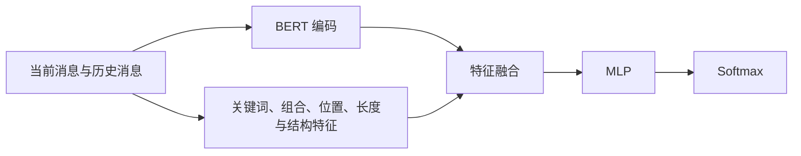
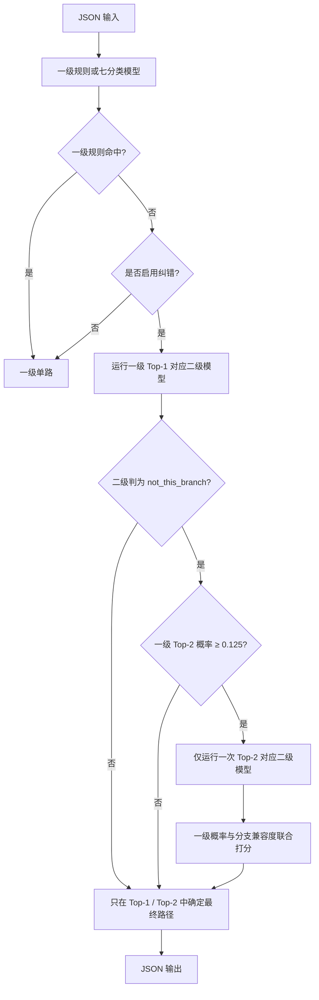

# Hierarchical Emotion Classifier


面向中文人机对话的二级情绪与交互状态分类器。系统由一个一级七分类模型和六个二级分类模型组成，融合语义表征、可解释文本特征、规则直通和自我纠错机制，输出当前用户消息的一、二级情感标签及把握程度。

## emotion分类体系

系统包含 **7 个一级类别、27 个非中性二级类别和 1 个中性终止类别，共 28 个最终叶节点**。

```text
emotion
├── neutral                              客观任务或无明确情绪
│   └── neutral                          中性终止类别
├── positive_acknowledgment              对回答或帮助的正向反馈
│   ├── approval                         认可、赞同
│   ├── gratitude                        感谢、感激
│   ├── relief                           放松、如释重负
│   └── realization                      理解、顿悟
├── positive_affect                      积极情感与正向互动
│   ├── affection                        喜爱、亲近
│   ├── dependency                       依赖、舍不得
│   ├── hope                             希望、期待
│   ├── joy                              高兴、喜悦
│   ├── pride                            自豪、成就感
│   ├── touched                          感动、动容
│   ├── playfulness                      戏谑、俏皮
│   └── caring                           关心、体谅与安慰
├── conflict_repair                      冲突与关系修复需求
│   ├── anger                            愤怒、斥责
│   ├── frustration                      受挫、卡壳
│   ├── impatience                       急躁、催促
│   ├── disappointment                   失望、预期落空
│   ├── guardedness                      戒备、保护边界
│   ├── disapproval                      不认可、否定观点或做法
│   └── disgust                          厌恶、嫌恶与排斥
├── emotional_support                    需要情绪支持的负向状态
│   ├── sadness                          悲伤、痛苦
│   ├── loneliness                       孤独、缺少陪伴
│   ├── anxiety                          担心、牵挂、焦虑
│   ├── guilt                            内疚、自责
│   └── embarrassment                    尴尬、难堪
├── cognitive_guidance                   认知求索与判断校正
│   ├── confusion                        困惑、不理解
│   ├── skepticism                       怀疑、质疑
│   └── curiosity                        好奇、探索
└── casual_engagement                    轻量休闲互动
    ├── gaming                           游戏相关互动
    └── boredom                          无聊、消遣
```

## 模型组成

每个分类器均采用“BERT 表征 + 可解释辅助特征 + MLP + Softmax”的结构：



- 一级模型输出一个 7 维概率向量。

- 每个二级模型在训练与内部推理时输出“分支真实子类 + `not_this_branch`”概率向量。`not_this_branch` 表示不属于此子类的概率，用于拒绝进入此类的样本，实现纠错。

- 最新消息优先进入 BERT，历史用户消息按由近到远拼接；超过 512 token 时优先截断较旧历史。

  七个模型分别为：`primary_emotion_classifier`、`positive_acknowledgment`、`positive_affect`、`conflict_repair`、`emotional_support`、`cognitive_guidance`、`casual_engagement`。

## 推理与纠错流程



## 运行环境

必须使用 NVIDIA GPU 和支持 CUDA 的 PyTorch。

已验证环境：

| 组件 | 版本 |
|---|---:|
| Python | 3.13.5 |
| PyTorch | 2.9.0+cu128 |
| Transformers | 5.15.0 |
| NumPy | 2.3.3 |
| Safetensors | 0.8.0 |
| Pydantic | 2.13.4 |
| Uvicorn | 0.52.4 |

先根据显卡和驱动安装适配的 CUDA 版 PyTorch，再安装其它依赖：

```powershell
python -m pip install transformers==5.15.0 numpy==2.3.3 safetensors==0.8.0 pydantic==2.13.4 uvicorn==0.52.4
python -c "import torch; print(torch.cuda.is_available()); print(torch.cuda.get_device_name(0))"
```

## 模型与基座准备

### 外部 BERT 基座

用户需要自行下载结构兼容的中文 BERT 基座，[下载地址](https://huggingface.co/hfl/chinese-bert-wwm)，并在 `config.json` 中分别指定：

| 配置项 | 用途 | 示例 |
|---|---|---|
| `paths.primary_bert_base` | 一级模型结构检查 | `./pretrained/primary_bert` |
| `paths.secondary_bert_base` | 六个二级模型结构检查 | `./pretrained/secondary_bert` |

两级可指向同一基座目录，也可在服务器上放置两个相同副本。外部目录至少应包含有效的 `config.json`。默认检查 BERT 类型、词表大小、隐藏维度、层数、注意力头数、中间层维度、最大位置数和 token type 数量。

## 项目结构

```text
root/
  ├── README.md
  ├── config.json                      模型参数
  ├── predict.py                       JSON/JSONL 命令行入口与输出契约
  ├── pipeline.py                      批量两级流水线
  ├── model_adapters.py                七个本地模型的隔离加载与推理
  ├── rejection_routing.py             二级拒识、单次Top-2纠错与联合打分
  ├── runtime.py                       配置、输入、缓存和设备锁
  ├── input.json                       单条示例
  ├── inputs.jsonl                     批量示例
  └── model/
      ├── primary_emotion_classifier/
      ├── positive_acknowledgment/
      ├── positive_affect/
      ├── conflict_repair/
      ├── emotional_support/
      ├── cognitive_guidance/
      └── casual_engagement/
```

## 命令行快速开始

进入 `root` 后运行，以下命令适用于 Windows PowerShell：

```powershell
# 单条json和批量jsonl
python predict.py --input input.json
python predict.py --input inputs.jsonl
```

### 命令行参数

| 参数 | 必填 | 说明 |
|---|---|---|
| `--input` | 是 | 单条 `.json` 或批量 `.jsonl`。 |
| `--output` | 否 | 覆盖配置中的默认输出路径。 |
| `--config` | 否 | 配置文件；默认使用当前目录的 `config.json`。 |

## 参数说明

### 路径与校验

| 字段 | 类型 | 含义 |
|---|---|---|
| `paths.output_json` | string | JSON 输入的默认输出路径。 |
| `paths.output_jsonl` | string | JSONL 输入的默认输出路径。 |
| `paths.primary_bert_base` | string | 一级 BERT 基座目录。 |
| `paths.secondary_bert_base` | string | 二级 BERT 基座目录。 |
| `validation.validate_bert_base_architecture` | boolean | 是否检查外部基座与打包编码器的结构兼容性。 |

### 路由与校准

| 字段 | 类型 / 范围 | 当前默认值与含义 |
|---|---|---|
| `routing.enable_correction` | boolean | `true`，允许二级拒识后检查一级 Top-2。 |
| `routing.top2_min_probability` | `[0,1]` | Top-2 低于该值时不启动纠错。 |
| `routing.compatibility_log_odds_weight` | `>=0` | 平衡一级概率与二级“属于本分支”对数优势。 |
| `routing.compatibility_log_odds_clip` | `>0` | 限制兼容度证据的最大影响，防止二级极端概率完全淹没一级。 |
| `routing.minimum_reversal_log_gain` | `>=0` | Top-2 反转 Top-1 所需的最低联合得分增益。 |
| `routing.rejection_thresholds` | object | 6个分支的 `not_this_branch` 概率阈值与相对最佳真实子类的差额阈值。 |
| `routing.primary_temperature` | `[0.1,10]` | 一级 Softmax 温度。 |
| `routing.secondary_temperatures` | object | 六个二级模型各自的 Softmax 温度。 |

### 推理与设备

| 字段 | 类型 / 范围 | 当前默认值与含义 |
|---|---|---|
| `inference.device` | CUDA device | 缺省设备。 |
| `inference.primary_device` | CUDA device | 一级实际执行设备。 |
| `inference.secondary_device` | CUDA device | 二级实际执行设备。 |
| `inference.max_length` | `3..512` | `512`，BERT 输入 token 上限。 |
| `inference.max_history_messages` | `0..4` | `4`，最多采用的历史用户消息数。 |
| `inference.batch_size` | `1..128` | `16`，批量推理大小。 |
| `inference.warmup_on_startup` | boolean | `true`，FastAPI 启动时预热一级和全部二级模型。 |
| `inference.gpu_acquire_timeout_seconds` | `>=0` | `0` 表示资源忙时持续等待；正数为超时秒数。 |
| `inference.clear_cuda_cache_after_branch` | boolean | 分支结束后是否释放 PyTorch 空闲显存缓存。 |

### 内部诊断

| 字段 | 类型 | 含义 |
|---|---|---|
| `diagnostics.routing_trace_enabled` | boolean | 是否记录内部路由证据，默认关闭。 |
| `diagnostics.routing_trace_jsonl` | string | 内部诊断 JSONL 路径，默认 `./scripts/model_runtime/routing_trace.jsonl`，相对本项目目录解析。 |

内部记录包含一级 Top-1/Top-2、是否拒绝、原始 `not_this_branch` 概率、原始叶子概率及公开条件概率，没有记录用户文本，可以根据需要新增其它字段。

## 输入格式

### 单条 JSON

```json
{
  "current_user_message": "你光道歉有什么用，我要的是解决问题，能不能快点？",
  "history_user_messages": []
}
```

| 字段 | 类型 | 必填 | 说明 |
|---|---|---|---|
| `current_user_message` | string | 是 | 当前分类目标，不能是空字符串或纯空白。 |
| `history_user_messages` | string[] | 否 | 最多四条历史用户消息，顺序为由近到远，省略时为空数组。 |

### 批量 JSONL

```jsonl
{"current_user_message":"谢谢！","history_user_messages":[]}
{"current_user_message":"请介绍一下 Python 列表推导式。","history_user_messages":[]}
{"current_user_message":"还是不对，请重新检查。","history_user_messages":["第一次运行报错了"]}
```

## 输出格式

JSON 输入输出一个 JSON 对象；JSONL 输入每个非空输入行对应一个输出行。

下面是一个实际输出结构示例。

```json
{
    "primary": {
        "label": "conflict_repair",
        "score": 0.9998528957366943,
        "scores": {
            "neutral": 0.00009294622577726841,
            "positive_acknowledgment": 7.5181646934652235e-6,
            "positive_affect": 1.9269891708972864e-6,
            "conflict_repair": 0.9998528957366943,
            "emotional_support": 0.00004121153324376792,
            "cognitive_guidance": 1.5535872535110684e-6,
            "casual_engagement": 1.961574753295281e-6
        }
    },
    "secondary": {
        "label": "impatience",
        "score": 0.9996016149951271,
        "scores": {
            "anger": 0.00007764351205238285,
            "frustration": 0.0002015873768201227,
            "impatience": 0.9996016149951271,
            "disappointment": 0.000019691842922353094,
            "guardedness": 0.00005179591969442512,
            "disapproval": 0.00002247974241729416,
            "disgust": 0.000025186610966322828
        }
    },
    "routing_meta": {
        "selected_path": "path_1_fast_path"
    },
    "final_decision": {
        "primary_label": "conflict_repair",
        "secondary_label": "impatience",
        "primary_score": 0.9998528957366943,
        "secondary_score": 0.9996016149951271
    }
}
```

### 输出字段

| 字段 | 含义 |
|---|---|
| `primary.label` | 纠错后的最终一级类别；与 `final_decision.primary_label` 一致。 |
| `primary.score` | 最终一级类别在一级原始概率向量中的概率。纠错后可能不是最大值。 |
| `primary.scores` | 一级模型原始七分类完整概率。 |
| `secondary.label` | 最终一级分支下的二级标签。 |
| `secondary.score` | 最终二级条件概率。 |
| `secondary.scores` | 最终一级分支的完整二级概率字典。 |
| `routing_meta.selected_path` | `path_1_fast_path` 或 `path_2_multi_path`。 |
| `final_decision` | 方便业务端直接读取的最终一、二级标签和对应概率。 |

- `primary.label` 不一定等于 `primary.scores` 的最大概率类别，因为 Top-2 纠错可能反转一级结果。
- 规则或高精度路由直通输出 one-hot 概率。
- `neutral` 输出固定为 `neutral → neutral`，二级概率固定为 `1.0`。

## 批量处理与资源调度

命令行 JSONL 采用一级、二级分阶段执行。二级样本按候选分支分组，同一分支批量推理，避免每条样本单独加载模型。

| 部署方式 | `primary_device` | `secondary_device` | 行为 |
|---|---|---|---|
| 单 GPU | `cuda:0` | `cuda:0` | 两阶段共享设备并排队执行。 |
| 双 GPU | `cuda:0` | `cuda:1` | 一级和二级可在不同批次上重叠执行。 |

